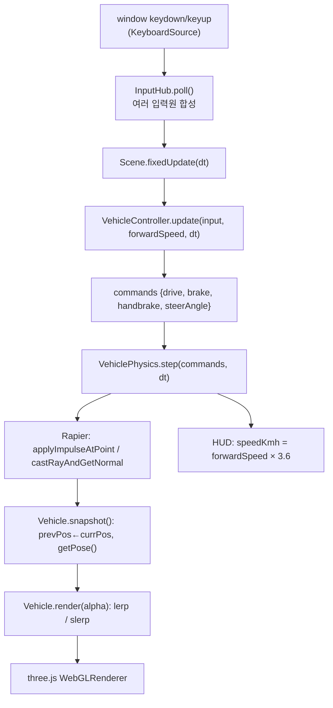

# 02 · 시스템 구조

모든 내용은 `rea inspect-web-page`, `rea export-web-scripts`,
`rea analyze-javascript-application`, `rea observe-web-execution`의 결과에 근거한다.
추정인 부분은 **[추정]**으로 표기한다.

## 1. 페이지 진입점

`https://jngbnss.github.io/f1/`의 HTML은 1,142 바이트이며 다음이 전부다.

```html
<div id="app"></div>
<div id="loading">Loading physics…</div>
<script type="module" crossorigin src="/f1/assets/index-CZ5aQSby.js"></script>
<link rel="modulepreload" href="/f1/assets/rolldown-runtime-hePW80VL.js">
<link rel="modulepreload" href="/f1/assets/three.core-ChCFGFa7.js">
<link rel="stylesheet" href="/f1/assets/index-CmeFmoOO.css">
```

- 화면은 전부 JavaScript가 만든다. HTML에는 게임 UI가 없다.
- `Loading physics…`라는 placeholder는 물리 엔진이 비동기 로드됨을 시사한다. **[관찰]**

## 2. 초기 로드 스크립트 (REA가 원문까지 보존한 9개)

`rea inspect-web-page --include-script-sources` 결과 (`evidence/script-inventory.json`).

| 파일 | 크기 (bytes) | 소스맵 | 역할 (코드에서 확인) |
| --- | ---: | --- | --- |
| `rolldown-runtime-hePW80VL.js` | 716 | 없음 | 번들러 런타임(모듈 레지스트리) |
| `index-CZ5aQSby.js` | 509,385 | 없음 | **진입 모듈**: 메뉴 UI, 차량/트랙 데이터, 차량 설정값 계산, 포스트프로세싱 |
| `three.core-ChCFGFa7.js` | 263,214 | 없음 | three.js 코어 |
| `three.module-mgjLJR3U.js` | 352,360 | 없음 | three.js 확장 모듈 |
| `Game-CGRrnhwj.js` | 4,787,386 | 없음 | **게임 본체**: 입력, 차량 물리, 카메라, HUD, 씬, 루프 |
| `cars-3LgIUEBS.js` | 8,975 | 없음 | 차량 목록 데이터 |
| `RaceManager-Cv7zsmMd.js` | 1,630 | 없음 | 레이스 상태기(카운트다운/랩/순위) |
| `Monaco_landmarks-CVcCt41_.js` | 18,598 | 없음 | 모나코 랜드마크 데이터 |
| `Monza_landmarks-BvqtwGKc.js` | 6,354 | 없음 | 몬차 랜드마크 데이터 |

**9개 전부 소스맵이 없다.** → 원본 파일명·함수명 복원 불가(한계).

## 3. 런타임에 추가로 로드되는 모듈 (지연 로딩)

`rea observe-web-execution`의 `script_inventory.main_document_scripts = 23`.
초기 9개 외에 레이스를 시작한 뒤 다음이 추가로 파싱되었다 **[관찰]**.

```
Melbourne-CGN1U0r3.js          · 선택한 서킷 데이터
Melbourne_osm-hxK_tx79.js      · OpenStreetMap 기반 주변 지형
Melbourne_woods-C25MB1jv.js    · 수목 배치
Melbourne_teamlines-1Qy6K0kO.js· 팀 라인
Melbourne_mintime-CMvgfxAc.js  · 기준 랩타임 데이터
TreeImpostors-7Actv1oT.js      · 나무 임포스터
ez-tree.es-D8AVxDiF.js         · 나무 생성 라이브러리
```

`Game-CGRrnhwj.js` 선두에 `__vite__mapDeps`가 있고 `assets/...js` 문자열이
동적 import 대상으로 등록되어 있다 → **서킷 단위 코드 분할(code splitting)**.
`rea analyze-javascript-application`도 `dynamic-import:assets/Monza_landmarks-...js`
노드를 `resolution: unresolved`로 기록했다(정적으로는 대상 모듈을 특정 못 함).

## 4. 사용 라이브러리 (코드에서 확인)

| 라이브러리 | 근거 |
| --- | --- |
| **three.js r186** | `index-CZ5aQSby.js`에 `THREE_REVISION: "186"` 정의 3회 |
| **Rapier (WASM 3D)** | `Game-CGRrnhwj.js`에 `new URL("rapier_wasm3d_bg.wasm", ...)`, `__wbg_*` wasm-bindgen 글루 |
| **postprocessing** | `LuminanceMaterial`, `EdgeDetectionMaterial`, `EffectMaterial`(SMAA 계열) |
| **ez-tree** | 런타임 동적 로드 `ez-tree.es-D8AVxDiF.js` |

Rapier 월드 초기화 코드(축약 식별자 `Ks`):

```js
this.world = new rapier.World({ x: 0, y: -9.81, z: 0 });
this.world.timestep = t;            // 고정 타임스텝을 물리 월드에 직접 지정
this.events = new rapier.EventQueue(true);
```

→ 중력 −9.81 m/s², 고정 스텝 물리. **DynamicRayCastVehicleController**도 export
목록에 보이지만, 차량은 **자체 레이캐스트 서스펜션 구현**을 쓴다(03 문서 참조).

## 5. 렌더링 구조

- `<canvas>` 1개에 three.js `WebGLRenderer`.
- `rea inspect-web-event-listeners ... canvas` 결과: 캔버스에 등록된 네이티브 리스너는
  `webglcontextlost` ×2, `webglcontextrestored`, `webglcontextcreationerror`뿐 **[관찰]**.
  → **캔버스는 입력을 받지 않는다.** 키 입력은 `window`에 붙는다(03 문서).
- 해상도 스케일러 존재: 클래스 `On`이 `renderer`, `maxRatio`, `minRatio`, `slowMs`, `fastMs`,
  `cooldownUntil`을 들고 있고, 화면 HUD에도 `resolution 0.50×`가 표시된다 →
  **프레임 시간에 따라 렌더 해상도를 동적으로 조절**한다.

## 6. 메인 루프 (확정)

`Game-CGRrnhwj.js` offset 4,735,400 부근, 클래스 `Rh`:

```js
class Rh {                        // FixedStepLoop
  fixedDt;                        // 생성자 기본값 1/60
  accumulator = 0;
  maxSubSteps = 5;
  tick = (now) => {
    this.rafId = requestAnimationFrame(this.tick);
    const frame = Math.min((now - this.lastTime) / 1000, 0.25);   // 프레임 상한 250 ms
    this.lastTime = now;
    this.accumulator += frame;
    let n = 0;
    while (this.accumulator >= this.fixedDt && n < this.maxSubSteps) {
      this.callbacks.fixedUpdate(this.fixedDt);
      this.accumulator -= this.fixedDt;
      n++;
    }
    if (n === this.maxSubSteps) this.accumulator = 0;              // 스파이럴 방지
    this.callbacks.update(frame, this.accumulator / this.fixedDt); // 두번째 인자 = 보간 alpha
    this.callbacks.render();
  };
}
```

> **고정 타임스텝(fixed timestep)**: 물리 계산을 항상 같은 시간 간격(여기선 1/60초)으로
> 돌려서 프레임레이트가 달라져도 결과가 흔들리지 않게 하는 기법.
> 남은 시간 비율(alpha)로 그림만 부드럽게 보간한다.

## 7. 실행 흐름 (확인된 체인)



이 체인의 각 단계는 **정적 코드 위치**와 **실행 관찰 카운트** 양쪽으로 확인했다(04 문서).

## 8. 상태 관리 방식

- 전역 상태 저장소(Redux류) 없음. **[관찰]**
- 클래스 인스턴스가 자기 상태를 소유한다:
  `KeyboardSource.down:Set` → `InputHub.state` → `VehicleController.{steer, brakePressure, commands}`
  → `VehiclePhysics.{wheels[], tyreGrip[], aero, ...}` → `Vehicle.{prevPos, currPos, prevQuat, currQuat}`.
- 레이스 진행 상태는 `RaceManager-Cv7zsmMd.js`의 단일 클래스가 소유:
  `state: "countdown" | "racing" | ...`, `countdown = 4`, `laps`, `finishOrder`,
  `get frozen() { return this.state === "countdown" }`.
- URL 쿼리에 선택이 반영된다: 스크린샷 시점 URL은
  `?car=f1-ferrari&track=melbourne&ai=19&laps=3` **[관찰]**.
