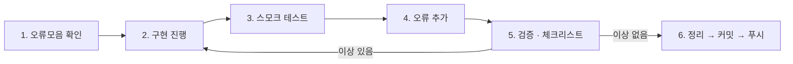

# 작업 워크플로

이 저장소의 **모든 구현 작업**은 아래 6단계를 순서대로 따른다.
단계를 건너뛰지 않으며, 각 단계의 산출물은 파일로 남긴다.



---

## 1. 오류모음 확인 (Error log review)

구현을 시작하기 **전에** `docs/errors.md`를 먼저 읽는다.

- 목적: 과거에 겪은 오류를 다시 겪지 않기 위함.
- 확인할 것: 같은 영역(예: REA 설치, CDP 연결, Vite 빌드)에서 이미 기록된 오류가 있는지.
- 이미 알려진 오류라면 기록된 복구 방법을 **먼저 적용**하고 시작한다.

> 용어: "오류모음(error log)"은 이 프로젝트에서 발생한 오류와 그 원인·복구 방법을
> 한 파일에 누적해 둔 목록이다. (`docs/errors.md`)

## 2. 구현 진행 (Implement)

- 분석으로 **확인된 사실**과 **자체 설계**를 코드 주석에서 `[분석확인]` / `[자체설계]`로 구분한다.
- 원본 게임의 소스코드를 복사하지 않는다. 분석으로 확인한 수식·구조만 재구현한다.
- 한 번에 한 가지 관심사만 바꾼다. 포매터 전역 실행 같은 부수 변경을 섞지 않는다.

## 3. 스모크 테스트 (Smoke test)

"테스트 파일을 쓰는 것"이 아니라 **실제로 프로그램을 돌려 보는 것**이다.

- 웹 데모: 개발 서버를 띄우고 실제 브라우저에서 키 입력 → 화면 반응을 확인한다.
- CLI/스크립트: 실제로 실행해 종료 코드와 출력을 확인한다.
- 근거로 남길 것: 실행 명령, 콘솔 출력, 필요하면 스크린샷.

## 4. 오류 추가 (Append errors)

스모크 테스트에서 발견한 오류를 `docs/errors.md`에 **즉시 추가**한다.

항목 형식:

```markdown
### E-00N · <한 줄 제목>
- 발생 단계: <설치 / 분석 / 구현 / 빌드 / 실행>
- 증상: <실제로 본 메시지나 현상 그대로>
- 원인: <확인된 원인 / 추정이면 "추정"이라고 명시>
- 복구: <실제로 통한 조치>
- 상태: 해결 | 우회 | 미해결
```

오류가 하나도 없었다면 "이번 라운드 신규 오류 없음"이라고 명시적으로 적는다.

## 5. 검증 및 체크리스트 확인 (Validate)

`docs/checklist.md`의 항목을 위에서부터 실제로 실행하고 결과를 표에 적는다.
한 항목이라도 실패하면 2단계로 돌아간다. **추정으로 통과 처리하지 않는다.**

## 6. 정리 → 커밋 → 푸시 (Ship)

1. 임시 파일·실험 스크립트 정리 (`.tmp/`는 커밋 대상 아님)
2. 문서 갱신 (`docs/`, `README.md`)
3. `git add` → `git commit` (한국어 커밋 메시지, 무엇을/왜)
4. `git push`
5. 푸시 후 다음 지시를 기다린다.

---

## 커밋 금지 대상

- 비밀키, 토큰, `.env`
- `node_modules/`, `dist/`
- 100MB에 가까운 대용량 Evidence 원본 → `.tmp/evidence/`에 두고 `docs/evidence/digests.json`에 SHA-256만 기록
- 재배포 권한이 없는 외부 3D 에셋·폰트·오디오
