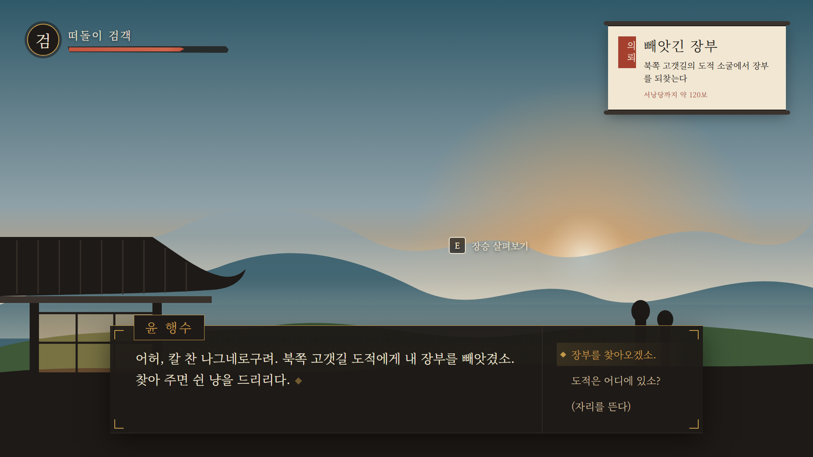

# 06. UI 시안과 서체

> 상태: 시안 v1. 목업: [`ui-mockup/index.html`](../ui-mockup/index.html) (브라우저로 열기), 스크린샷: [`img/ui-mockup.png`](img/ui-mockup.png)
> 검사: `tests/test_ui_mockup.py` (팔레트 토큰 일치, 팔레트 밖 색 사용 금지, 제목 서체 글리프 범위, 대사가 정책 데이터와 일치)

배경은 게임 화면 자리 표시용 SVG다. 아트 디렉션(02번)의 해 질 녘 색과 대기 원근을 미리 보여 주려고 넣었다.

> 스크린샷은 `word-break: keep-all` 적용 **직전**에 찍었다. 그래서 퀘스트 두루마리의 "장부/를"이 어절 중간에서 줄바뀜되어 있다. HTML은 수정되었고, 작업 PC의 헤드리스 크롬이 계속 시간 초과로 끝나서 다시 찍지 못했다. 브라우저로 `ui-mockup/index.html`을 직접 열면 수정된 상태를 볼 수 있다.

## 1. 서체

| 용도 | 서체 | 라이선스 | 한글 범위 | 이유 |
|---|---|---|---|---|
| 제목·이름표·도장 | **Song Myung (송명)** | SIL OFL 1.1 | **KS X 1001 2,350자만** | 전통 명조 디스플레이 느낌이 강하다. 고정 문자열에만 쓴다 |
| 본문·대사·선택지 | **Gowun Batang (고운바탕)** | SIL OFL 1.1 | 11,172자 전체 | 본문으로 읽기 좋고 Bold가 있다. AI가 어떤 글자를 내도 깨지지 않는다 |
| 제목 대안 | 나눔명조 ExtraBold | SIL OFL 1.1 | 11,172자 | Song Myung에 없는 글자가 필요할 때 |

- **AI 대사에는 절대 Song Myung을 쓰지 않는다.** LLM이 2,350자 밖의 글자를 내면 빈칸으로 나온다. 테스트가 `f-title` 클래스 문자열이 KS X 1001 범위 안인지 검사한다.
- 공공기관 무료 서체(국립박물관문화재단 클래식, KoPub, 조선일보체)는 쓰지 않는다. 수정 금지 조항이 있어 서브셋이나 Godot MSDF 변환이 문제가 될 수 있다.
- 빌드에는 OFL.txt를 서체마다 함께 넣는다.

## 2. 구성 요소

| 요소 | 위치 | 디자인 | 비고 |
|---|---|---|---|
| 체력 | 좌상단 | 먹색 원형 문장 + 붓질 끝처럼 비스듬히 잘린 바(`hp_red`) | 체력이 30% 아래로 내려가면 바가 천천히 맥박 |
| 퀘스트 두루마리 | 우상단 | 한지 바탕, 위아래 두루마리 축, 붉은 도장("의뢰") | 목표가 바뀌면 두루마리가 말렸다 펴지는 0.4초 애니메이션 + 스팅 |
| 상호작용 안내 | 대상 옆 월드 공간 | 키캡 + 동사 | 문구는 "대화하기"가 아니라 "장승 살펴보기"처럼 대상 이름을 넣는다 |
| 대화창 | 하단 중앙, 폭 1400px | 먹색 반투명 패널, 위쪽 황토색 실선, 네 모서리 꺾쇠(창살 문양을 단순화) | 본문 30px, 2줄 기준 |
| 이름표 | 대화창 왼쪽 위에 걸침 | 황토색 테두리 + Song Myung | |
| 선택지 | 대화창 오른쪽 열 | 선택된 항목은 황토색 + 마름모 표시 | 게임 이벤트가 붙은 선택지만 퀘스트를 움직인다 |
| 타이핑 표시 | 본문 끝 | 깜박이는 황토색 마름모 | 스트리밍 중에는 글자가 타이핑 효과로 나온다 |

## 3. 규칙

- **색은 팔레트 토큰만 쓴다.** 테스트가 CSS에서 팔레트 밖의 hex를 찾으면 실패한다(체력 바 하이라이트 1개만 예외).
- 대비: 본문 4.5:1 이상, 체력 바 같은 비텍스트 UI는 3:1 이상. `data/palette.json`의 `contrast_pairs`로 검사한다. 이 검사로 처음 고른 단청 빨강(`#A5402F`)이 어두운 패널 위에서 2.78:1밖에 안 된다는 것을 발견했고, UI 전용 `hp_red`(`#C4553F`, 3.88:1)를 추가했다.
- 기준 해상도는 1920×1080이고 Godot에서는 `canvas_items` 스트레치 + `keep` 비율로 맞춘다. 대화 본문은 1280×720에서도 20px 이상이어야 한다.
- `word-break: keep-all`처럼 **어절 단위로 줄을 바꾼다.** Godot `Label`·`RichTextLabel`에서는 `autowrap_mode = AUTOWRAP_WORD_SMART`로 확인한다.
- 화면에 "AI"라는 표시를 하지 않는다. AI 대사와 고정 대사가 플레이어에게 똑같이 보여야 몰입이 깨지지 않는다.

## 4. Godot 구현 메모

- `Theme` 리소스 하나에 팔레트와 서체를 모은다. 색은 `palette.json`에서 생성하는 스크립트를 1주차에 만든다(손으로 옮겨 적지 않는다).
- 대화창은 `PanelContainer` + `StyleBoxFlat`(배경, 위쪽 테두리) + 모서리 꺾쇠 `TextureRect` 4개로 만든다.
- 체력 바의 붓질 모양은 `TextureProgressBar`에 붓 질감 텍스처를 넣어 만든다.
- 두루마리와 도장은 9-patch 텍스처로 만든다.

## 5. 다음 시안에서 할 것

- 선택지 3개 이상일 때, 대사가 3줄일 때의 레이아웃
- 피격 시 화면 가장자리 붉은 비네트(`hp_red`, 0.2초)
- 엔딩 카드와 타이틀 화면
- 실제 게임 화면 스크린샷 위에 다시 맞춰 보기 (3주차 뷰티 코너)
