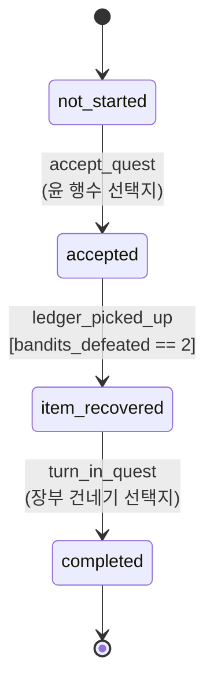
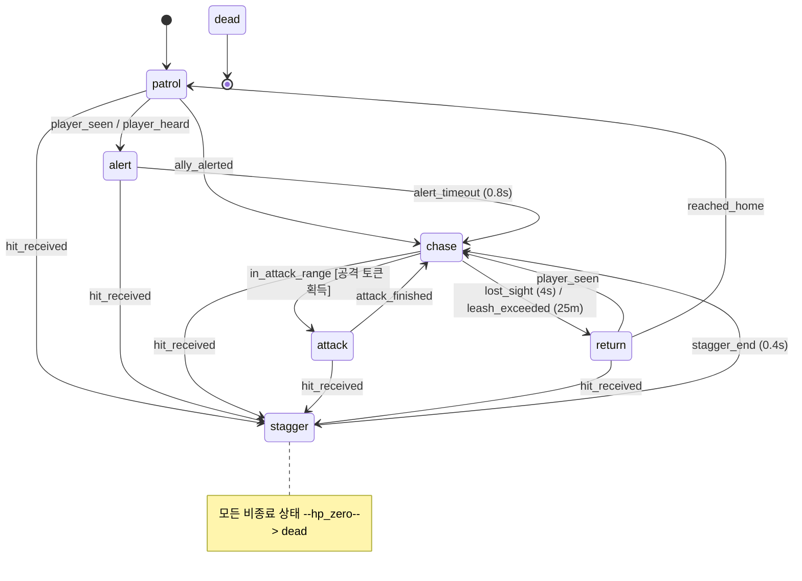
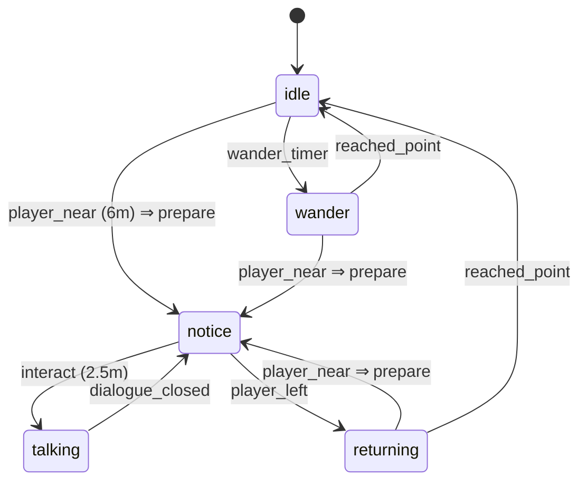

# 12. 퀘스트 상태도와 NPC FSM

> 상태: 초안 (팀 검토 후 확정)
> 기계 판독 원본: [`data/quest_lost_ledger.json`](../data/quest_lost_ledger.json), [`data/npc_fsm.json`](../data/npc_fsm.json)
> 검사: `python -m tools.fsm` (도달 불가 상태, 막다른 상태, 중복 전이, 종료 불가 상태 검출)

이 문서와 JSON이 다르면 **JSON이 정답**이다. Godot 쪽 `QuestManager`와 적 AI는 이 JSON을 Resource로 변환해 읽는다.

## 1. 퀘스트 `lost_ledger` (빼앗긴 장부)

| 상태 | 목표 문구 | 마커 | AI 문맥 |
|---|---|---|---|
| `not_started` | 장터의 윤 행수와 이야기한다 | 윤 행수 | 의뢰 전 |
| `accepted` | 북쪽 고갯길의 도적 소굴에서 장부를 되찾는다 | 도적 소굴 | 수락, 미회수 |
| `item_recovered` | 윤 행수에게 장부를 돌려준다 | 윤 행수 | 회수, 미반납 |
| `completed` | (없음, 엔딩 시퀀스) | 없음 | 보상 지급 완료 |

**설계 결정**

- **상태를 바꾸는 이벤트는 세 개뿐이고, 모두 게임이 만든다.** 두 개는 대화창의 *고정 선택지*(`dialogue_policy.json`의 `game_event`), 하나는 월드 상호작용(상자)이다. LLM 응답에는 상태를 바꾸는 필드가 아예 없다(응답 스키마 `additionalProperties: false`).
- 장부 상자는 도적 둘이 모두 쓰러져야 열린다. 플레이어가 전투를 건너뛰고 장부만 들고 오는 동선을 막는다.
- 정의되지 않은 (상태, 이벤트) 조합은 **무시하고 로그만 남긴다.** 예외를 던지지 않는다. 시연 중 순서가 꼬여도 게임이 멈추지 않게 하기 위해서다.
- 사망 시 마지막 체크포인트(마을 입구, 고갯길 장승)에서 부활하고 퀘스트 상태와 처치 수는 유지한다. 재도전 비용이 낮아야 8~10분 안에 끝난다.

## 2. 도적 FSM

**게임 필에 직결되는 수치** (`params`, 1주차 이후 플레이테스트로 조정)

| 항목 | 값 | 이유 |
|---|---|---|
| 공격 토큰 | 1 | 둘이 동시에 때리면 플레이어가 읽을 수 없다. 토큰이 없는 도적은 거리를 두고 원을 돈다. |
| 공격 예고(windup) | 0.45s | 무기 반짝임 + 소리로 예고. 회피·선제타가 가능해야 "내가 잘해서 이겼다"는 느낌이 난다. |
| 경직 | 0.4s + 히트스톱 0.06s | 타격감의 핵심. 히트스톱은 P0. |
| 체력 | 60 (플레이어 검 20 → 3타) | 전투 1회 40~70초 목표. |
| alert 시간 | 0.8s | 들킨 순간을 플레이어가 인지할 여유. 소리 지르기 애니메이션과 함께. |
| leash | 25m | 마을까지 쫓아오지 않게. |

## 3. 마을 NPC FSM (윤 행수, 덕순 주모)

**상태 캐시가 핵심이다.** `QuestManager.quest_state_changed`가 발생하면 두 NPC의 다음 대사 후보를 백그라운드에서 만들어 상태별 캐시에 저장한다. 플레이어가 6m 안에 들어오면(`notice`) 캐시를 확인하고, 없을 때만 2초 제한 요청을 시작한다. 상호작용 시점까지 검증된 응답이 없으면 고정 대사를 즉시 표시한다.

## 4. Godot 구현 메모

- `QuestManager`(autoload)가 `transitions`를 `{(from, event): to}` 테이블로 들고 `emit(event)`만 노출한다. 상태 변경은 `quest_state_changed(old, new)` 시그널로만 알린다.
- 적 FSM은 `enum` 상태와 `match` 문으로 충분하다. LimboAI 같은 플러그인은 9번 호환성 표 결과를 보고 결정한다.
- `bandits_defeated`는 `GameState`(autoload)에만 있고, 적의 `dead` 진입 시 `+1` 한다.
