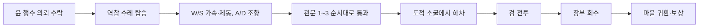

# JOSEON OUTLAW × 레이싱 혼합 설계

## 결정

두 기존 게임을 별도 메뉴로 병렬 배치하지 않고, `JOSEON OUTLAW`의 장부 회수 퀘스트 안에 레이싱 데모의 운전 루프를 넣는다. 의뢰를 받은 뒤 역참 수레를 몰아 세 개의 관문을 순서대로 통과하고, 도적 소굴에서 내려 기존 검 전투와 장부 회수를 이어 간다.

웹 레이싱 데모와 Godot 게임을 iframe·프로세스 전환으로 연결하지 않는다. 엔진과 입력 루프가 달라 화면·상태·배포가 분리되기 때문이다. 수레 조종을 Godot에서 다시 구현해 한 실행 파일, 한 카메라, 한 퀘스트 상태를 유지한다.

## 플레이 루프

## 두 게임에서 유지하는 핵심

| 원본 루프 | 혼합판에서 유지하는 것 |
|---|---|
| F1 재현 데모 | 가속·제동 분리, 조향 슬루율, 속도에 따른 최대 조향각 감소, 추격 카메라, 속도 HUD, 리셋 |
| JOSEON OUTLAW | 3인칭 도보, NPC 대화, 명시적 퀘스트 상태, 도적 전투, 장부 회수, 보상과 엔딩 |

F1 차량 수치를 조선 수레에 그대로 쓰지 않는다. 입력 필터와 조종 감각만 유지하고 최고속도·가속도·휠베이스는 수레용 자체 설계값을 사용한다.

## 상태와 책임

- `QuestManager`의 공개 상태(`not_started → accepted → item_recovered → completed`)는 유지한다. 기존 대화 정책과 AI 계약을 깨지 않는다.
- `CourierCart`가 탑승 여부, 속도, 관문 진행도, 운송 완료 여부를 소유한다.
- 장부 궤짝은 `도적 전원 제압`과 `운송 완료`를 모두 만족해야 열린다.
- 플레이어가 탑승하면 도보 물리·시각·카메라를 끄고 수레 카메라를 활성화한다. 하차 시 반대로 복구한다.
- 관문은 반드시 순서대로 통과한다. 마지막 관문 통과 후 결과는 퀘스트 완료 전까지 유지한다.
- 사망·수레 리셋은 퀘스트 상태를 되돌리지 않는다.

## 조작과 피드백

- 수레 근처 `E`: 탑승. 탑승 중 `E`: 하차.
- `W`: 전진 가속, `S`: 제동/후진, `A/D`: 조향, `R`: 수레를 출발점으로 복구.
- 탑승 중에는 별도 HUD에 속도와 `관문 n/3`을 표시한다.
- 월드에는 세 개의 금빛 관문과 순번 표식을 둔다. 다음 관문만 밝게 표시한다.
- 수레를 타지 않았거나 관문을 끝내지 않은 채 궤짝을 조사하면 운송을 먼저 마치라는 피드백을 준다.

## 수레 물리

- 고정 물리 프레임에서 스칼라 전후 속도와 조향각을 적분한다.
- 가속·제동·구름 저항은 `move_toward`로 제한한다.
- 조향 입력은 꺾기보다 복귀가 빠른 슬루율을 사용한다.
- 최대 조향각은 속도 정규화 `n`과 `n(2-n)` 곡선으로 저속 32도에서 고속 8도까지 감소한다.
- 요 회전은 자전거 모델 `yaw_rate = speed / wheelbase × tan(steer_angle)`로 계산한다.
- 충돌은 `CharacterBody3D.move_and_slide()`로 처리하고 충돌 시 속도를 감쇠한다.

## 완료 기준

1. 의뢰 수락 전에는 수레에 탑승할 수 없다.
2. 탑승·운전·하차 때 플레이어와 카메라가 정확히 한 쪽에서만 활성화된다.
3. 실제 물리 프레임에서 수레가 세 관문을 순서대로 통과한다.
4. 운송 전에는 도적을 쓰러뜨려도 장부를 획득할 수 없다.
5. 운송 후에는 기존 전투→장부→귀환→보상 흐름을 완주한다.
6. 헤드리스 스모크와 실제 렌더 화면에서 수레·관문·HUD를 확인한다.
